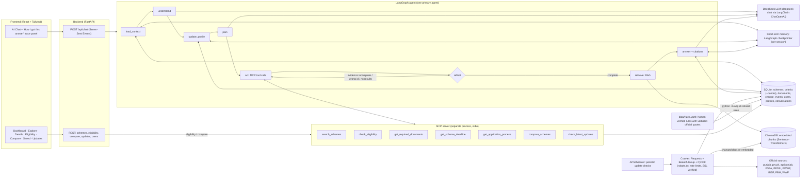

# PunjabScheme AI: Architecture

## 1. Component diagram



## 2. Why each part exists

| Part | Responsibility | Why this design |
|---|---|---|
| **LangGraph agent** | Understands, plans, calls tools, reflects, retrieves, answers | Explicit nodes make every decision observable (action trace) and testable |
| **LLM (DeepSeek; Groq optional)** | Language understanding, fact extraction, tool planning, answer writing | Never decides eligibility. The rule engine does. |
| **MCP server** | Structured, verifiable tools over SQLite | Real protocol boundary (separate process); the same tools power the chat and the UI pages |
| **Rule engine** (`eligibility.py`) | Deterministic pass / fail / unknown / manual per criterion | Reproducible verdicts with the official quote behind each one |
| **RAG** (ChromaDB + Sentence-Transformers) | Finds official text excerpts to ground and cite answers | Shared knowledge from documents, kept separate from user memory |
| **Short-term memory** | Messages, profile and recent schemes inside one session | Follow-ups such as "the second one" or "actually I'm a university student" |
| **Long-term memory** (SQLite) | Consented profile, saved schemes, conversation summaries | Recalled in a new session; deletable by the user |
| **Crawler + APScheduler** | Discover schemes, snapshot pages/PDFs, hash-compare, re-index | Detects new schemes and changed requirements automatically |
| **rules.yaml (human-verified)** | Structured criteria copied verbatim from official pages | Human oversight: changed sources flag rules for re-verification instead of silently changing verdicts |

## 3. One chat turn, step by step

1. **load_context**: the privacy guard masks CNIC/phone/IBAN/card/email. The agent loads short-term state (checkpointer) and, on the first turn of a session, the saved profile and last conversation summary (SQLite). If official rules for previously recommended schemes changed since the last check, it records a replan reason.
2. **understand** (LLM, JSON): language, intent, newly stated facts, referenced schemes (resolving "the second one" from short-term memory), and an English search query.
3. **update_profile**: merges the facts. A *corrected* fact (e.g. matric → undergraduate) is a replan trigger. Saves to SQLite only with consent.
4. **plan** (LLM, JSON, validated): an ordered tool plan with a reason for each step. Version numbers make replans visible (v1 → v2). A rule-based planner is the fallback.
5. **act**: executes each step through the **MCP client**. The profile is attached automatically to `check_eligibility`.
6. **reflect**: checks the evidence. Unknown scheme id → retry with the closest match; empty filtered search → broaden; schemes found but not checked → add an eligibility step. It then computes verdict changes versus the previous plan and ranks the missing facts (ask at most 3).
7. **retrieve**: semantic search in ChromaDB for official excerpts (focused on one scheme when referenced).
8. **answer** (LLM): writes only from the numbered evidence, cites `[n]`, prints "Not Officially Confirmed" for gaps, then stores the turn (with its trace) in SQLite.

Every node emits trace events (`memory`, `privacy`, `understanding`, `plan`, `replan`, `tool_call`, `tool_result`, `retrieval`, `reflection`, `answer`, `warning`), which are streamed live to the UI.

## 4. Update pipeline

```
APScheduler (every UPDATE_INTERVAL_HOURS) or "Run update check" / CLI
  -> for each official source: robots.txt + Content-Signal check -> fetch seeds -> follow scheme links / PDFs
  -> extract text -> relevance filter (drops tenders, procurement, HR notices)
  -> new URL?            -> documents + change_event(new_document) ; scheme-like page -> schemes(origin=discovered) + change_event(new_scheme)
  -> same URL, new hash? -> diff -> change_event(content_changed, severity) ; if a curated scheme's page changed in
                            eligibility-related text -> rules_status = needs_reverification (pending_review)
  -> source down?        -> sources.status = unreachable | ssl_error | suspended | blocked_by_robots
  -> re-embed only changed documents into ChromaDB ; write snapshots/manifest.json (offline rebuild)
Human: read the diff, update data/rules.yaml, bump last_verified, run `python -m app.cli reload-rules`
  -> change_event(rules_reloaded, verified) ; agents re-plan for sessions that relied on the old rules
```

## 5. Data model (SQLite)

See `backend/app/db.py` for the full schema. Main tables: `sources`, `documents`, `schemes`,
`scheme_criteria` (field, operator, value, condition, **quote**, source_url), `scheme_items`
(benefits / documents / steps with quotes), `change_events`, `users`, `user_profiles`, `saved_schemes`,
`conversations`, `messages` (each assistant message stores its full action trace).
